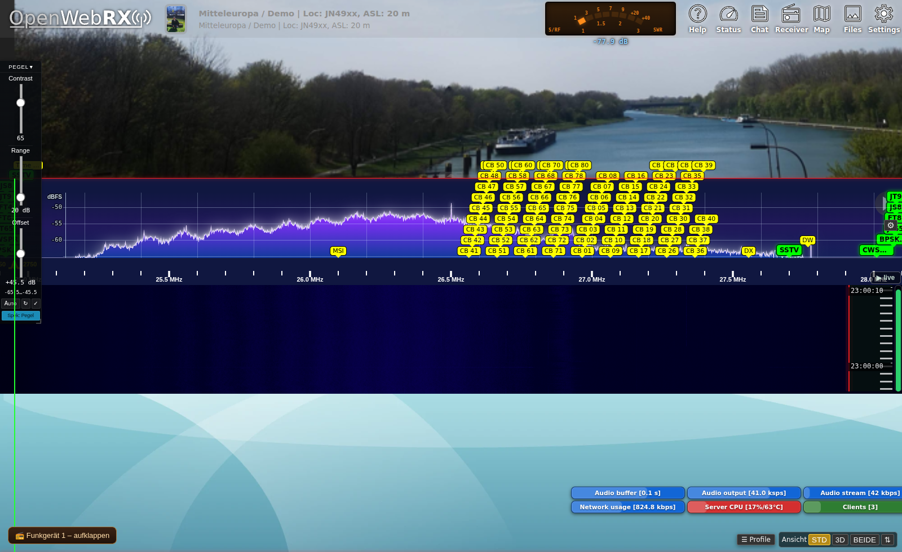
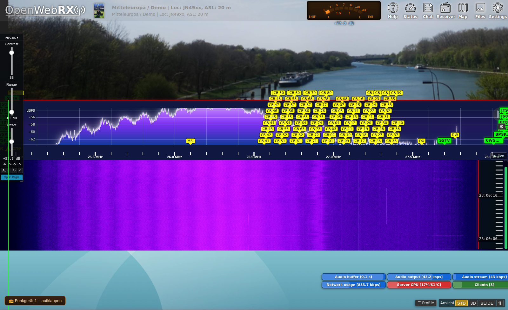
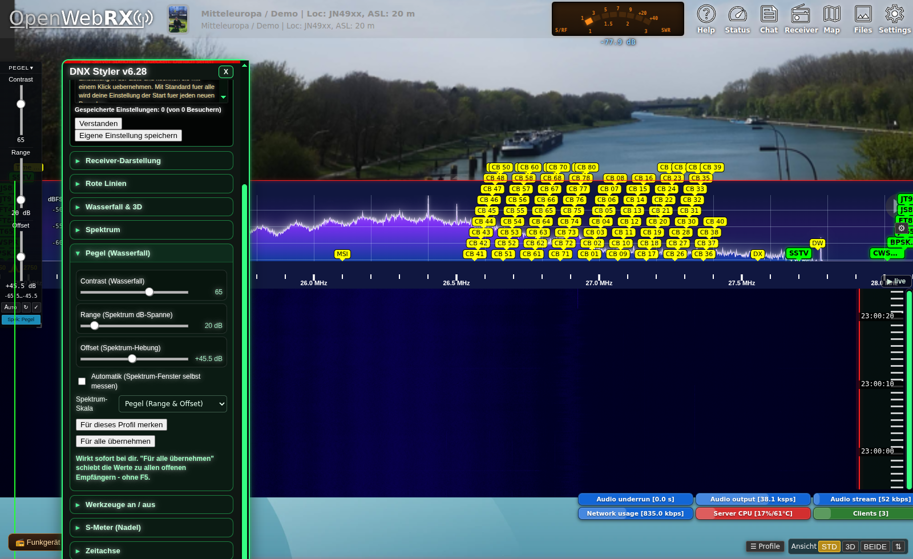
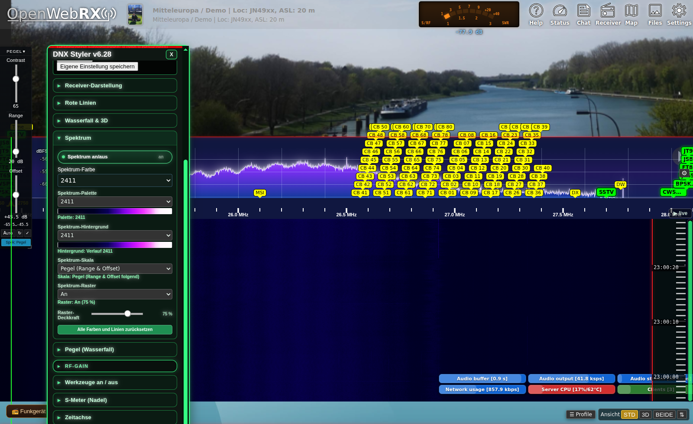

# DNX Pegel (`v1.0.0` / `waterfall_pro.js v6.62`)

<!-- DNX-DISCLAIMER-START -->
> **Wichtiger Hinweis / Vollständige Distanzierung (Hobby-Mod-Mode)**
>
> - **Vollständige Distanzierung:** Ich distanziere mich in jeder Hinsicht vollständig vom Projekt **OpenWebRX / OpenWebRX+** sowie dessen Entwicklern und Betreibern. Es besteht keinerlei Verbindung, Zusammenarbeit, Prüfung, Befürwortung oder Partnerschaft.
> - **Keine öffentlichen/offiziellen OpenWebRX-Plugins (nur Mod-Mode):** Bei diesem Projekt handelt es sich ausdrücklich **nicht** um ein öffentliches oder offizielles Plugin von OpenWebRX, sondern ausschließlich um einen privaten, inoffiziellen **Mod-Mode** (Eigenmodifikation).
> - **Warum bewusst kein reines Browser-JavaScript (Mod-Mode-Architektur):** Viele Funktionen (z. B. serverseitige Speicherung, Konten-/Rollenverwaltung, Profil-Synchronisation, VNC-/websockify-Brücken, geschützte Schnittstellen, Docker-/Systemintegration und stabile UI-Anpassungen) lassen sich sauber und sicher nicht allein über simples Client-JavaScript umsetzen, ohne den OpenWebRX-Kern umzubauen oder Browsergrenzen zu umgehen. Deshalb setzt dieses Projekt bewusst auf getrennte Begleitmodule, Shell-Installer und Dienste im **Mod-Mode** statt alles künstlich in reines JavaScript zu pressen.
> - **Kein öffentlicher Support & keine Haftung:** Es gibt **keinen öffentlichen Support**, keine Garantie und keine Haftung. Nutzung, Installation und Anpassung erfolgen vollständig auf eigene Gefahr (immer vorher Backups anlegen und zunächst im eigenen Testsystem prüfen).
> - **Reines Hobbyprojekt – frei nutzbar, änderbar & verbreitbar:** Dieses Projekt entsteht ausschließlich aus reinem Hobby und Interesse am gemeinsamen Funk-/SDR-Hobby. Es steht ausdrücklich frei zur Verfügung und darf frei genutzt, weiterverbreitet, verändert und verbessert werden.
<!-- DNX-DISCLAIMER-END -->

> **Important Notice / Full Disassociation (Hobby Mod-Mode Only)**
>
> - **Full Disassociation:** I completely disassociate myself from **OpenWebRX / OpenWebRX+** and its developers/maintainers. There is no affiliation, endorsement, review, or partnership of any kind.
> - **No Official/Public OpenWebRX Plugins (Mod-Mode Only):** These files are **not** official or public OpenWebRX plugins, but purely unofficial hobby modifications (*mod-mode*).
> - **No Public Support & No Warranty:** There is **no public support**, no warranty, and no liability. Use entirely at your own risk (always create backups and verify on a test system first).
> - **Pure Hobby Project — Free to Use, Modify & Redistribute:** Created solely out of personal hobby interest in the radio/SDR hobby; freely available to use, share, modify, and improve.

<!-- DNX-PREVIEW-START -->
## Live-Vorschau & Galerie / Live Preview (`DNX Pegel`)



| Ansicht / View | Beschreibung / Description | Screenshot |
|---|---|---|
| **PEGEL-Seitenleiste (`Contrast`, `Range`, `Offset`)** | Freies Andock-Panel (`links`/`rechts`, verschiebbar, skalierbar, einklappbar) mit `Contrast` (`0–100`), `Range` (`6–160 dB`), `Offset` (`-40..+140 dB`), `Auto`, Reset (`↺`), Spektrum-Umschalter (`Spek: Pegel`/`Auto`) und exakter dBFS-Skala |  |
| **Entkopplung Spektrum vs. Wasserfall** | Engeres Spektrumfenster (`Range 10 dB`, `Offset +53.5 dB`) zoomt nur die Spektrumkurve und dBFS-Achse, während `Contrast 88` gezielt die Wasserfall-Farbverteilung anhebt |  |
| **Profilspeicherung im `DNX Styler` (optional)** | Nahtlose Brücke zum `#dnx-blk-pegel`-Block (`Für dieses Profil merken` / `Für alle übernehmen`) samt `RF-GAIN` |  |
| **Spektrum-Skala & dBFS-Raster (`v6.11` / `v6.62`)** | Optionales Zusammenspiel mit dem kalibrierten Spektrum-Raster (`Spektrum-Skala: Pegel (Range & Offset)`, `Raster: An 75 %`) |  |
<!-- DNX-PREVIEW-END -->

Eigenständiger **SDR#/Airspy-Pegelregler** (`waterfall_pro.js v6.62` + `waterfall_pro.css v6.60`) für OpenWebRX / OpenWebRX+ mit sauberer **Entkopplung von Spektrum-Dynamik und Wasserfall-Kontrast**.

Standalone **SDR#/Airspy-style level control rail** (`waterfall_pro.js v6.62` + `waterfall_pro.css v6.60`) for OpenWebRX / OpenWebRX+ with clean separation between **spectrum dynamics (`Range` & `Offset`)** and **waterfall contrast (`Contrast`)**.

---

## Funktionsprinzip: Saubere Entkopplung wie bei SDR# / Airspy

| Regler | Bereich | Wirkung | Beeinflusst **nicht** |
|---|---|---|---|
| **`Contrast`** | `0 – 100` (`STD: 50`) | Verteilt ausschließlich die **Wasserfall-Farben (`Waterfall.colors`)** über eine SDR#-Gammakurve (`50` = neutral `1:1`; `< 50` senkt Rausch-Helligkeit; `> 50` hebt schwache Signale im Wasserfall an). | Verändert weder die Spektrumkurve noch `Range` / `Offset`. |
| **`Range`** | `6 – 160 dB` (`STD: 20 dB`) | Bestimmt die vertikale **dB-Spanne des RF-Spektrums** (`lo = hi - range`) und die linke `dBFS`-Skala. | Verändert weder `Waterfall.levels` noch die Wasserfallfarben. |
| **`Offset`** | `-40 .. +140 dB` (`STD: +58 dB`) | Verschiebt die **obere Spektrumgrenze** (`hi = -offset`, `lo = hi - range`) vertikal im Spektrumfenster (`+dB` schiebt das Signal nach oben, `-dB` nach unten). | Greift **nicht** in den Wasserfall oder die native OpenWebRX-Auto-/Manuell-Wasserfallsteuerung ein. |
| **`Auto` & `↺`** | Einmal-/Dauer-Fit / Reset | `Auto` vermisst per Histogramm (`p10` / `p999`) das aktuelle Signal und kalibriert `Range` & `Offset` sofort auf das Spektrum; `↺` stellt die Standardwerte wieder her; `Spek: Pegel / Auto` schaltet zwischen Range/Offset-Skala und automatischer Rauschfloor-Skala um. | — |

### Weitere Funktionen

- **Vollständig eigenständig nutzbar:** Läuft direkt über `install.sh` ohne `DNX Styler` (eingebauter `INLINE_CSS`-Fallback, keine externen Abhängigkeiten).
- **Profilbezogener Vorrat (`dnx.wfpro.profiles`):** Speichert je SDR-Band/Profil eigene `Range`-, `Offset`-, `Contrast`- und `autoFit`-Werte im `localStorage` (`dnx.wfpro.state.v3`).
- **Mausrad-Feinsteuerung:** Drehen auf einem Regler ändert in `1`-/`2`-dB-Schritten, mit gehaltener `Umschalt`-Taste in `0,5`-dB-Feinschritten.
- **Flexibles Panel:** Frei ziehbar am Titel `PEGEL`, an allen `8` Rändern/Ecken skalierbar (`--rail-h`), einklappbar (`▼`/`▲`) und nach links oder rechts andockbar.
- **Weiß-Schutz bei RF-Gain-Sprüngen (`weissSchutz`):** Reagiert automatisch auf `dnx-rf-gain`-Ereignisse, sodass plötzliche Gain-Anhebungen den Wasserfall nicht dauerhaft übersteuern.
- **Optionale Integration mit `DNX-Styler` & `styler_share.py`:** Stellt `window.__dnxPegelLesen`, `window.__dnxPegelSet`, `window.__dnxPegelProfile`, `window.__dnxPegelProfileSet` und `window.__dnxPegelMerken` für `#dnx-blk-pegel` und die serverweite Standardverteilung (`:8098`) bereit.

---

## Dateien im Paket / Package Contents

| Datei | Ziel / Target | Zweck / Purpose |
|---|---|---|
| `install.sh` | Host (`root`/`sudo`) | Universal-Installer (`install`, `update`, `status`, `uninstall`, Docker & nativ, automatische Backups in `/opt/dnx-pegel-backups`) |
| `files/waterfall_pro.js` | `…/htdocs/plugins/receiver/waterfall_pro/waterfall_pro.js` | Pegel-Modul (`v6.62`) inkl. `INLINE_CSS`-Fallback |
| `files/waterfall_pro.css` | `…/htdocs/plugins/receiver/waterfall_pro/waterfall_pro.css` | Stylesheet (`v6.60`) für die vertikale Pegel-Seitenleiste |
| `loader-example.js` | Referenz | Beispiel-Snippet für manuelles Laden in `plugins/receiver/init.js` |
| `docs/` | — | `4` bereinigte Funktionsscreenshots (`1600×980`) |
| `LICENSE`, `SHA256SUMS.txt` | — | MIT-Lizenz & Prüfsummen |

---

## Installation / Upgrade

```bash
chmod +x install.sh
sudo ./install.sh install

# Native OpenWebRX-Installation (ohne Docker):
sudo TYP=normal PLUGINS=/usr/lib/python3/dist-packages/htdocs/plugins ./install.sh install

# Docker mit anderem Containernamen:
sudo TYP=docker CONTAINER=owrx-8013 ./install.sh install

# Status, Update & Entfernen:
./install.sh status
sudo ./install.sh update
sudo ./install.sh uninstall

# Prüfsummen verifizieren:
sha256sum -c SHA256SUMS.txt
```

Nach der Installation den Browser einmal mit **`Strg+F5`** neu laden.
